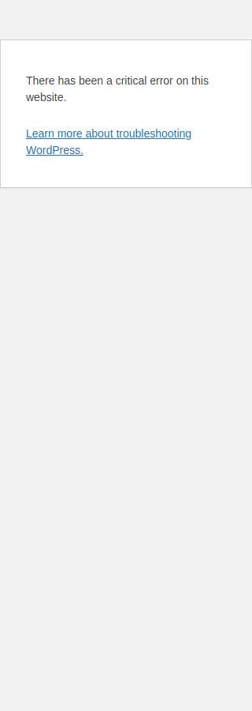
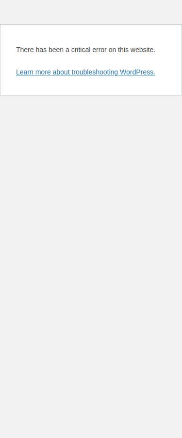
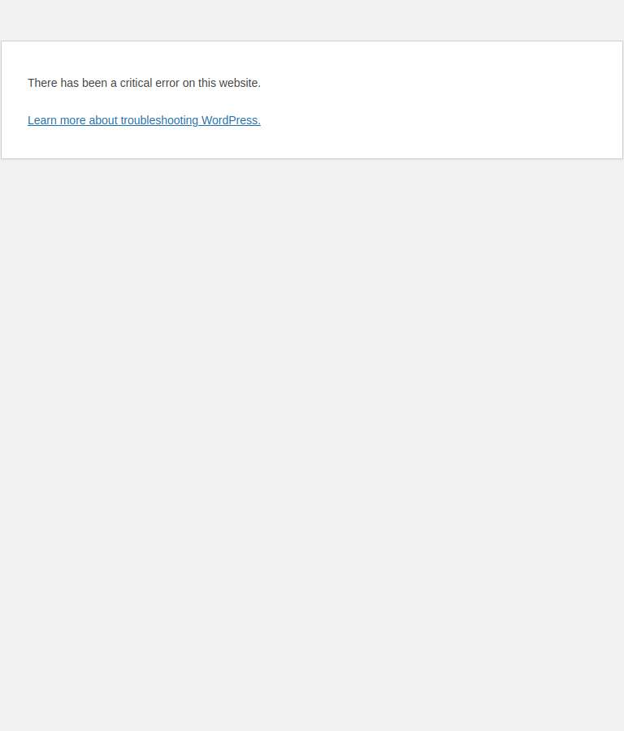
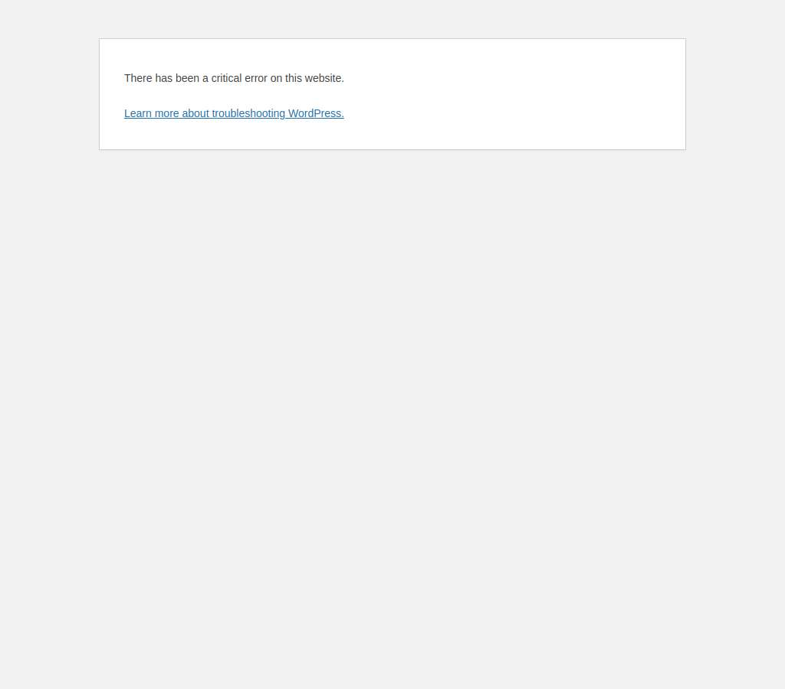
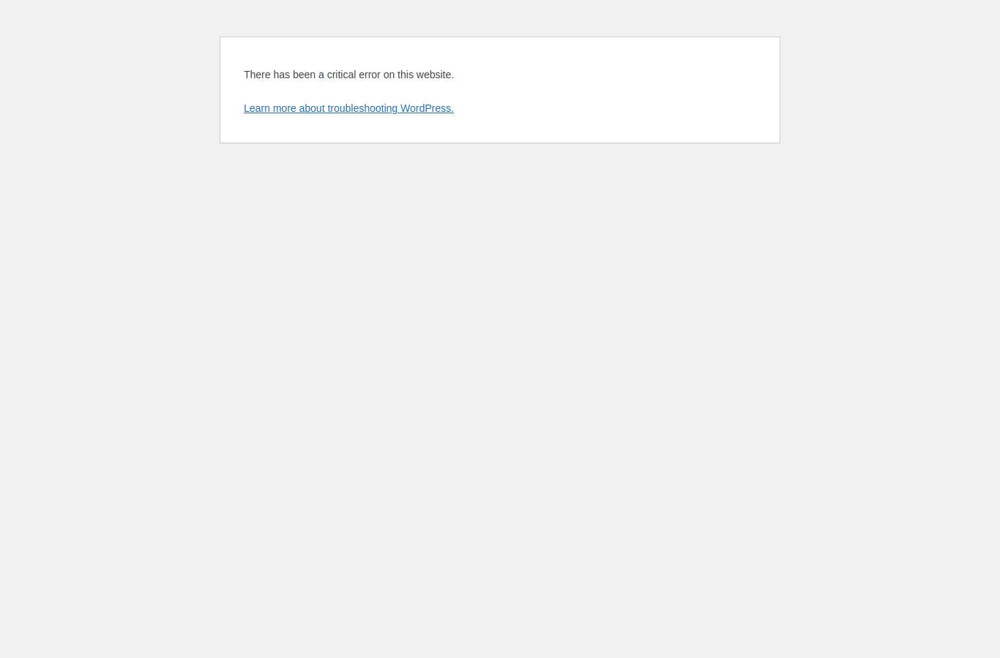
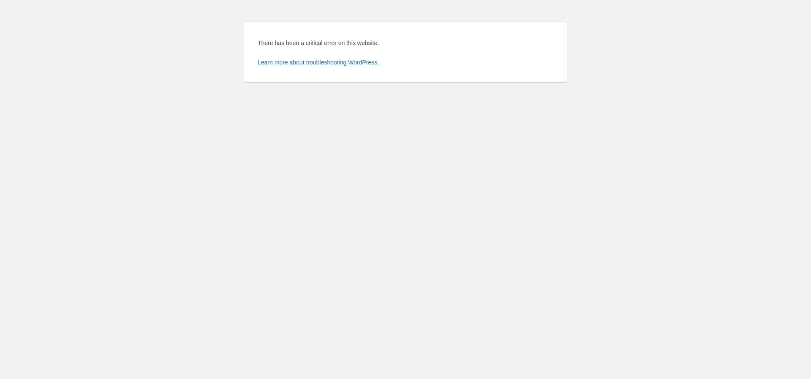

# Next Level Digitals — Fix homepage typo: 'buketio' → 'but' in the portfolio intro line
Request **R20261113-001** · 2026-11-13 · Status **QA failed**

## Requested
Fix the typo on the homepage: "buketio" → "but".

## Changed
- `page.update_section` post 7593 elementor

## Checks
- ❌ HTTP 500 on /
- ❌ HTTP 500 on /
- ❌ HTTP 500 on /
- ❌ HTTP 500 on /
- ❌ HTTP 500 on /
- ❌ HTTP 500 on /

## Scores (Lighthouse, mobile)
not run

## Screens
| Page | Width | Before | After |
|---|---|---|---|
| / | 320 |  |  |
| / | 375 |  |  |
| / | 768 |  |  |
| / | 1024 |  |  |
| / | 1366 |  |  |
| / | 1920 |  |  |

## Rollback
Snapshot is taken automatically at go-live. Revert: run **Rollback** with site `nextleveldigitals`, request `R20261113-001`.
